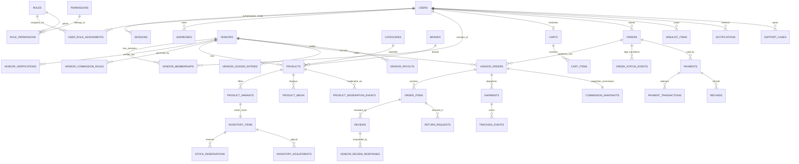

# Wear Birgunj — Entity-Relationship Diagram (ERD) & Data Dictionary

## 1. Entity-Relationship Diagram

---

## 2. Data Dictionary & Table Specifications

### Domain A: Identity & Access
| Table | Primary Key | Key Columns & Types | Constraints & Retention |
|---|---|---|---|
| `users` | `id TEXT` | `email TEXT UNIQUE`, `phone TEXT`, `full_name TEXT`, `password_hash TEXT`, `mfa_enabled BOOLEAN`, `mfa_secret TEXT`, `status TEXT` (`ACTIVE`, `SUSPENDED`, `DELETED`), `email_verified_at TIMESTAMPTZ` | Retention: Active account lifetime; anonymized on deletion. |
| `sessions` | `id TEXT` | `user_id TEXT FK`, `token_hash TEXT UNIQUE`, `csrf_token TEXT`, `ip_address TEXT`, `user_agent TEXT`, `expires_at TIMESTAMPTZ`, `revoked_at TIMESTAMPTZ` | Purged 30 days after expiry/revocation. |
| `roles` | `id TEXT` | `name TEXT UNIQUE` (`CUSTOMER`, `VENDOR_OWNER`, `VENDOR_STAFF`, `SUPPORT_AGENT`, `CATALOG_MODERATOR`, `FINANCE_OPERATOR`, `PLATFORM_ADMIN`, `SUPER_ADMIN`) | System seed lookup. |
| `permissions` | `id TEXT` | `code TEXT UNIQUE`, `description TEXT` | System seed lookup. |
| `role_permissions` | `(role_id, permission_id)` | Composite PK linking roles to granular permissions | Cascade on role removal. |
| `user_role_assignments` | `id TEXT` | `user_id TEXT FK`, `role_id TEXT FK`, `assigned_by TEXT` | `UNIQUE(user_id, role_id)`. |
| `verification_tokens` | `id TEXT` | `user_id TEXT FK`, `purpose TEXT` (`EMAIL_VERIFY`, `PASSWORD_RESET`, `STEP_UP_MFA`), `token_hash TEXT UNIQUE`, `expires_at TIMESTAMPTZ`, `used_at TIMESTAMPTZ` | Single-use (`used_at IS NULL`); short-lived (15–60 min). |
| `addresses` | `id TEXT` | `user_id TEXT FK`, `full_name TEXT`, `phone TEXT`, `ward_number INT`, `street_address TEXT`, `landmark TEXT`, `city TEXT DEFAULT 'Birgunj'`, `delivery_instructions TEXT`, `is_default BOOLEAN` | `CHECK (ward_number BETWEEN 1 AND 32)`. |
| `vendor_memberships` | `id TEXT` | `user_id TEXT FK`, `vendor_id TEXT FK`, `role TEXT` (`OWNER`, `STAFF`), `permissions_json TEXT`, `status TEXT` (`ACTIVE`, `REVOKED`) | `UNIQUE(user_id, vendor_id)`. Authoritative source of vendor tenant scope. |

### Domain B: Vendors & Marketplace Finance
| Table | Primary Key | Key Columns & Types | Constraints & Retention |
|---|---|---|---|
| `vendors` | `id TEXT` | `slug TEXT UNIQUE`, `business_name TEXT`, `description TEXT`, `logo_url TEXT`, `banner_url TEXT`, `pan_vat_number TEXT`, `contact_email TEXT`, `contact_phone TEXT`, `ward_number INT`, `address_text TEXT`, `approval_status TEXT` (`PENDING_VERIFICATION`, `APPROVED`, `REJECTED`, `SUSPENDED`), `rating_avg NUMERIC(3,2)`, `rating_count INT`, `payout_method TEXT`, `payout_account_ref TEXT` | Protected from accidental deletion (`ON DELETE RESTRICT`). |
| `vendor_verifications` | `id TEXT` | `vendor_id TEXT FK`, `document_type TEXT`, `private_object_key TEXT`, `status TEXT` (`PENDING`, `VERIFIED`, `REJECTED`), `reviewed_by TEXT`, `review_notes TEXT`, `reviewed_at TIMESTAMPTZ` | Private object keys only; never public URLs. |
| `vendor_commission_rules` | `id TEXT` | `vendor_id TEXT NULL FK`, `category_id TEXT NULL FK`, `rate_bps INT`, `fixed_fee_paisa INT DEFAULT 0`, `is_active BOOLEAN`, `effective_from TIMESTAMPTZ` | `CHECK (rate_bps BETWEEN 0 AND 5000)`. |
| `vendor_ledger_entries` | `id TEXT` | `vendor_id TEXT FK`, `vendor_order_id TEXT NULL FK`, `entry_type TEXT` (`CREDIT_SALE`, `DEBIT_COMMISSION`, `DEBIT_REFUND`, `DEBIT_PAYOUT`, `ADJUSTMENT`), `amount_paisa INT`, `balance_after_paisa INT`, `currency TEXT DEFAULT 'NPR'`, `description TEXT`, `created_at TIMESTAMPTZ` | Immutable append-only financial record (7-year retention). |
| `vendor_payouts` | `id TEXT` | `vendor_id TEXT FK`, `amount_paisa INT`, `currency TEXT DEFAULT 'NPR'`, `status TEXT` (`REQUESTED`, `APPROVED`, `PROCESSING`, `PAID`, `FAILED`, `REJECTED`), `destination_snapshot TEXT`, `provider_ref TEXT`, `approved_by TEXT`, `processed_at TIMESTAMPTZ` | `CHECK (amount_paisa > 0)`. |

### Domain C: Catalog, Variants, Media, Moderation & Inventory
| Table | Primary Key | Key Columns & Types | Constraints & Retention |
|---|---|---|---|
| `categories` | `id TEXT` | `slug TEXT UNIQUE`, `name TEXT`, `description TEXT`, `image_url TEXT`, `parent_id TEXT NULL FK`, `sort_order INT`, `is_active BOOLEAN` | Indexed by `slug` and `sort_order`. |
| `brands` | `id TEXT` | `slug TEXT UNIQUE`, `name TEXT`, `logo_url TEXT`, `is_local_brand BOOLEAN DEFAULT FALSE` | Indexed by `slug`. |
| `products` | `id TEXT` | `vendor_id TEXT FK`, `category_id TEXT FK`, `brand_id TEXT NULL FK`, `slug TEXT UNIQUE`, `title TEXT`, `subtitle TEXT`, `description TEXT`, `specifications_json TEXT`, `moderation_status TEXT` (`DRAFT`, `PENDING_APPROVAL`, `ACTIVE`, `REJECTED`, `SUSPENDED`), `rejection_reason TEXT`, `base_price_paisa INT`, `compare_at_price_paisa INT NULL`, `currency TEXT DEFAULT 'NPR'`, `is_featured BOOLEAN`, `is_new BOOLEAN`, `rating_avg NUMERIC(3,2) DEFAULT 0`, `review_count INT DEFAULT 0` | `CHECK (base_price_paisa >= 0)`. Composite index `(vendor_id, moderation_status, updated_at)`. |
| `product_variants` | `id TEXT` | `product_id TEXT FK`, `sku TEXT UNIQUE`, `title TEXT`, `size_value TEXT`, `color_name TEXT`, `color_hex TEXT`, `price_paisa INT`, `compare_at_price_paisa INT NULL`, `currency TEXT DEFAULT 'NPR'`, `weight_grams INT DEFAULT 300`, `status TEXT` (`ACTIVE`, `INACTIVE`) | `CHECK (price_paisa >= 0)`. |
| `product_media` | `id TEXT` | `product_id TEXT FK`, `url TEXT`, `object_key TEXT`, `alt_text TEXT`, `sort_order INT`, `moderation_status TEXT DEFAULT 'APPROVED'` | Ordered by `sort_order ASC`. |
| `product_moderation_events` | `id TEXT` | `product_id TEXT FK`, `actor_id TEXT FK`, `from_status TEXT`, `to_status TEXT`, `reason TEXT`, `created_at TIMESTAMPTZ` | Audit history for every moderation state change. |
| `inventory_items` | `id TEXT` | `variant_id TEXT UNIQUE FK`, `vendor_id TEXT FK`, `available_qty INT`, `reserved_qty INT DEFAULT 0`, `low_stock_threshold INT DEFAULT 5`, `updated_at TIMESTAMPTZ` | `CHECK (available_qty >= 0 AND reserved_qty >= 0)`. |
| `stock_reservations` | `id TEXT` | `inventory_item_id TEXT FK`, `order_id TEXT NULL FK`, `customer_id TEXT FK`, `quantity INT`, `status TEXT` (`ACTIVE`, `CONFIRMED`, `RELEASED`, `EXPIRED`), `expires_at TIMESTAMPTZ` | `CHECK (quantity > 0)`. |
| `inventory_adjustments` | `id TEXT` | `inventory_item_id TEXT FK`, `actor_id TEXT FK`, `delta_qty INT`, `previous_qty INT`, `new_qty INT`, `reason TEXT`, `created_at TIMESTAMPTZ` | Immutable inventory audit log. |

### Domain D: Cart, Orders, Payments, Shipments & After-Sales
| Table | Primary Key | Key Columns & Types | Constraints & Retention |
|---|---|---|---|
| `coupons` | `id TEXT` | `code TEXT UNIQUE`, `description TEXT`, `discount_type TEXT` (`PERCENTAGE`, `FIXED_PAISA`), `discount_value INT`, `min_order_paisa INT DEFAULT 0`, `max_discount_paisa INT NULL`, `usage_limit INT NULL`, `used_count INT DEFAULT 0`, `is_active BOOLEAN`, `expires_at TIMESTAMPTZ` | `CHECK (discount_value > 0)`. |
| `carts` | `id TEXT` | `customer_id TEXT UNIQUE FK`, `coupon_code TEXT NULL`, `updated_at TIMESTAMPTZ` | 1 active cart per authenticated customer. |
| `cart_items` | `id TEXT` | `cart_id TEXT FK`, `product_id TEXT FK`, `variant_id TEXT FK`, `quantity INT` | `UNIQUE(cart_id, variant_id)`, `CHECK (quantity > 0)`. |
| `orders` | `id TEXT` | `order_number TEXT UNIQUE` (`#WB123456`), `customer_id TEXT FK`, `status TEXT` (`NEW`, `PROCESSING`, `OUT_FOR_DELIVERY`, `DELIVERED`, `CANCELLED`, `RETURNED`), `payment_method TEXT` (`ESEWA`, `KHALTI`, `COD`), `payment_status TEXT` (`PENDING`, `PAID`, `PENDING_COD`, `FAILED`, `REFUNDED`), `subtotal_paisa INT`, `discount_paisa INT`, `tax_paisa INT`, `shipping_paisa INT`, `total_paisa INT`, `currency TEXT DEFAULT 'NPR'`, `coupon_code TEXT NULL`, `shipping_name TEXT`, `shipping_phone TEXT`, `shipping_ward INT`, `shipping_address TEXT`, `shipping_landmark TEXT`, `delivery_instructions TEXT`, `estimated_delivery_text TEXT`, `idempotency_key TEXT` | `CHECK (total_paisa >= 0)`. Snapshot of customer address & pricing at purchase time. |
| `vendor_orders` | `id TEXT` | `order_id TEXT FK`, `vendor_id TEXT FK`, `vendor_order_number TEXT UNIQUE`, `status TEXT` (`NEW`, `PROCESSING`, `OUT_FOR_DELIVERY`, `DELIVERED`, `CANCELLED`, `RETURNED`), `subtotal_paisa INT`, `discount_paisa INT`, `tax_paisa INT`, `shipping_paisa INT`, `total_paisa INT`, `commission_rate_bps INT`, `commission_paisa INT`, `net_vendor_paisa INT`, `currency TEXT DEFAULT 'NPR'`, `delivered_at TIMESTAMPTZ NULL`, `cancelled_at TIMESTAMPTZ NULL`, `cancel_reason TEXT NULL` | Indexed by `(vendor_id, status, created_at DESC)`. |
| `order_items` | `id TEXT` | `order_id TEXT FK`, `vendor_order_id TEXT FK`, `product_id TEXT FK`, `variant_id TEXT FK`, `vendor_id TEXT FK`, `product_title_snapshot TEXT`, `variant_title_snapshot TEXT`, `sku_snapshot TEXT`, `image_url_snapshot TEXT`, `unit_price_paisa INT`, `quantity INT`, `line_total_paisa INT`, `currency TEXT DEFAULT 'NPR'` | `CHECK (quantity > 0 AND unit_price_paisa >= 0)`. |
| `order_status_events` | `id TEXT` | `order_id TEXT FK`, `vendor_order_id TEXT NULL FK`, `status TEXT`, `title TEXT`, `description TEXT`, `actor_id TEXT NULL`, `created_at TIMESTAMPTZ` | Powers customer & vendor order timeline. |
| `payments` | `id TEXT` | `order_id TEXT FK`, `provider TEXT` (`ESEWA`, `KHALTI`, `COD`), `status TEXT` (`INITIATED`, `CAPTURED`, `PENDING_COD`, `FAILED`, `REFUNDED`), `amount_paisa INT`, `currency TEXT DEFAULT 'NPR'`, `provider_reference TEXT NULL`, `verified_at TIMESTAMPTZ NULL` | 7-year financial retention. |
| `payment_transactions` | `id TEXT` | `payment_id TEXT FK`, `attempt_number INT`, `status TEXT`, `provider_payload_summary TEXT`, `created_at TIMESTAMPTZ` | Audit log of gateway attempts. |
| `refunds` | `id TEXT` | `payment_id TEXT FK`, `order_id TEXT FK`, `vendor_order_id TEXT NULL FK`, `return_request_id TEXT NULL FK`, `amount_paisa INT`, `reason TEXT`, `status TEXT` (`PENDING`, `COMPLETED`, `FAILED`), `processed_by TEXT NULL`, `created_at TIMESTAMPTZ` | `CHECK (amount_paisa > 0)`. |
| `shipments` | `id TEXT` | `vendor_order_id TEXT UNIQUE FK`, `carrier_name TEXT DEFAULT 'Birgunj Express Local'`, `tracking_number TEXT UNIQUE`, `delivery_partner_name TEXT`, `delivery_partner_phone TEXT`, `status TEXT` (`PREPARING`, `OUT_FOR_DELIVERY`, `DELIVERED`, `EXCEPTION`), `estimated_delivery TEXT`, `dispatched_at TIMESTAMPTZ NULL`, `delivered_at TIMESTAMPTZ NULL` | Powers Screen #9 Order Tracking & Delivery Partner card. |
| `tracking_events` | `id TEXT` | `shipment_id TEXT FK`, `status TEXT`, `title TEXT`, `description TEXT`, `location_text TEXT`, `event_time TIMESTAMPTZ` | Ordered chronologically (`event_time ASC`). |
| `return_requests` | `id TEXT` | `order_id TEXT FK`, `vendor_order_id TEXT FK`, `order_item_id TEXT FK`, `customer_id TEXT FK`, `vendor_id TEXT FK`, `request_type TEXT` (`RETURN`, `EXCHANGE`), `reason TEXT`, `status TEXT` (`REQUESTED`, `APPROVED`, `REJECTED`, `COMPLETED`), `refund_amount_paisa INT`, `resolution_notes TEXT NULL`, `requested_at TIMESTAMPTZ`, `resolved_at TIMESTAMPTZ NULL` | Validated against 36-hour post-delivery window. |
| `commission_snapshots` | `id TEXT` | `vendor_order_id TEXT UNIQUE FK`, `vendor_id TEXT FK`, `rule_id TEXT NULL`, `rate_bps INT`, `gross_amount_paisa INT`, `commission_paisa INT`, `net_vendor_paisa INT`, `currency TEXT DEFAULT 'NPR'`, `created_at TIMESTAMPTZ` | Immutable purchase-time commission record. |

### Domain E: Customer Trust, Support & Reliability
| Table | Primary Key | Key Columns & Types | Constraints & Retention |
|---|---|---|---|
| `wishlist_items` | `id TEXT` | `customer_id TEXT FK`, `product_id TEXT FK`, `created_at TIMESTAMPTZ` | `UNIQUE(customer_id, product_id)`. |
| `reviews` | `id TEXT` | `product_id TEXT FK`, `order_item_id TEXT FK`, `customer_id TEXT FK`, `vendor_id TEXT FK`, `rating INT`, `comment TEXT`, `media_urls_json TEXT DEFAULT '[]'`, `moderation_status TEXT` (`PUBLISHED`, `PENDING`, `HIDDEN`, `REJECTED`), `is_verified_purchase BOOLEAN DEFAULT TRUE`, `created_at TIMESTAMPTZ` | `CHECK (rating BETWEEN 1 AND 5)`, `UNIQUE(customer_id, order_item_id)`. |
| `vendor_review_responses` | `id TEXT` | `review_id TEXT UNIQUE FK`, `vendor_id TEXT FK`, `actor_id TEXT FK`, `response_text TEXT`, `created_at TIMESTAMPTZ` | Vendor can respond only to reviews on its own products. |
| `support_cases` | `id TEXT` | `case_number TEXT UNIQUE`, `customer_id TEXT FK`, `order_id TEXT NULL FK`, `subject TEXT`, `category TEXT`, `status TEXT` (`OPEN`, `IN_PROGRESS`, `RESOLVED`, `CLOSED`), `priority TEXT`, `assigned_to TEXT NULL`, `internal_notes TEXT NULL` | `internal_notes` restricted to Support/Admin roles. |
| `notifications` | `id TEXT` | `user_id TEXT FK`, `title TEXT`, `body TEXT`, `type TEXT`, `link_url TEXT NULL`, `is_read BOOLEAN DEFAULT FALSE`, `created_at TIMESTAMPTZ` | Indexed by `(user_id, is_read, created_at DESC)`. |
| `webhook_inbox` | `id TEXT` | `provider TEXT`, `provider_event_id TEXT`, `event_type TEXT`, `signature_valid BOOLEAN`, `payload_json TEXT`, `processing_status TEXT` (`RECEIVED`, `PROCESSED`, `FAILED`, `IGNORED`), `attempts INT DEFAULT 1`, `processed_at TIMESTAMPTZ NULL`, `created_at TIMESTAMPTZ` | `UNIQUE(provider, provider_event_id)`. |
| `idempotency_keys` | `id TEXT` | `actor_id TEXT`, `operation TEXT`, `idempotency_key TEXT`, `request_hash TEXT`, `response_status INT`, `response_body_json TEXT`, `expires_at TIMESTAMPTZ` | `UNIQUE(actor_id, operation, idempotency_key)`. |
| `audit_logs` | `id TEXT` | `actor_id TEXT NULL`, `actor_role TEXT`, `vendor_id TEXT NULL`, `action TEXT`, `target_type TEXT`, `target_id TEXT`, `reason TEXT NULL`, `metadata_json TEXT`, `correlation_id TEXT`, `ip_address TEXT NULL`, `created_at TIMESTAMPTZ` | Append-only security & administrative audit log. |
