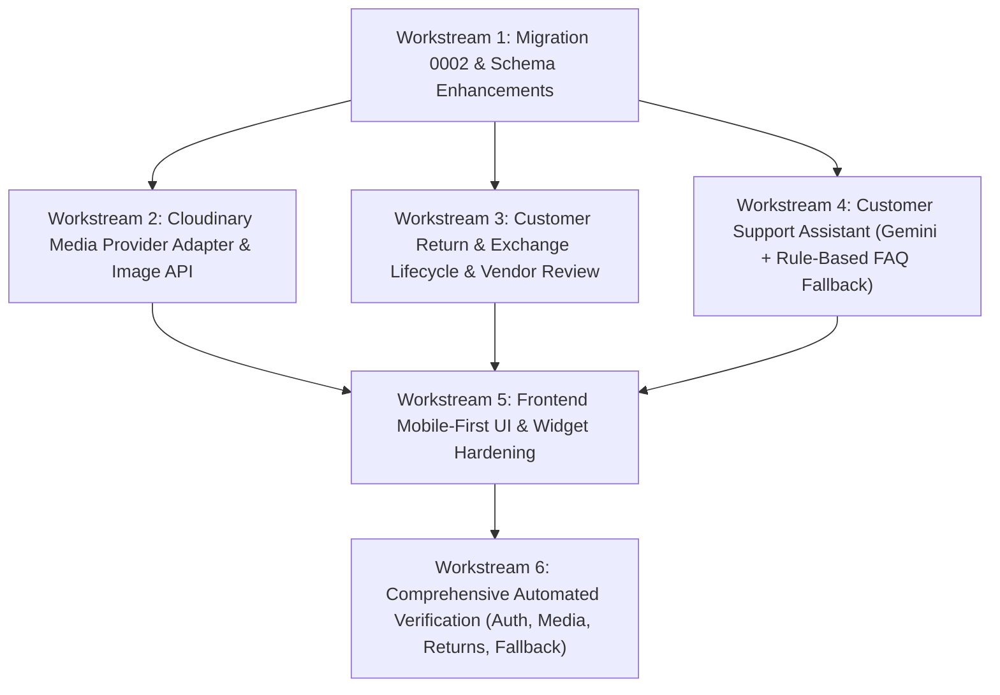

# Wear Birgunj — Production Hardening & Final Implementation Plan

This implementation plan governs the completion, security hardening, and production polish of the **Wear Birgunj** standalone multivendor e-commerce platform according to the 36-section PRD and the Antigravity Final Implementation Prompt.

---

## 1. Baseline Audit & Architecture Confirmation

- **Architecture**: Modular monolith built from scratch. Node.js LTS, TypeScript, NestJS 11 + Fastify (`/api/v1`), PostgreSQL 16 (embedded PGlite locally / external `pg.Pool` via `DATABASE_URL`), React 19 + Vite + Tailwind CSS.
- **Strict Prohibition**: No Medusa, no third-party blackbox commerce engines.
- **Security Posture & Credential Gate**:
  - The project owner will rotate exposed credentials when access is restored.
  - Zero live credentials in source code, `.env.example`, git history, or frontend bundles.
  - Cloudinary media adapter and Gemini chatbot adapter fail closed or show a clear, safe fallback when credentials are empty/unconfigured.
  - Passwords hashed with Argon2id; session tokens hashed with SHA-256; CSRF and rate limiting active.
  - Server-side tenant isolation: vendor endpoints resolve `vendor_id` strictly from authenticated `vendor_memberships` rows.

---

## 2. Implementation Workstreams & Dependencies

### Workstream 1: Schema Enhancements & Persistence (Migration 0002)
- Added `replacement_variant_id`, `customer_explanation`, `evidence_urls_json`, `rejection_reason`, and `pickup_address_text` to `return_requests`.
- Updated status state machine on `return_requests` to support:
  `REQUESTED`, `UNDER_REVIEW`, `APPROVED`, `REJECTED`, `AWAITING_CUSTOMER_ACTION`, `PICKUP_OR_SHIPMENT_PENDING`, `ITEM_RECEIVED`, `EXCHANGE_PROCESSING`, `REFUND_PROCESSING`, `COMPLETED`, `CANCELLED`.
- Added `is_primary`, `width`, `height`, `format` to `product_media`.
- Added `support_messages` table for multi-turn customer support conversations and chatbot escalation.

### Workstream 2: Cloudinary Media Upload & Validation
- **Provider Adapter**: `CloudinaryMediaService` detects presence of `CLOUDINARY_CLOUD_NAME`, `CLOUDINARY_API_KEY`, `CLOUDINARY_API_SECRET`.
  - When credentials missing: returns clear, graceful error or local dev placeholder without throwing unhandled exceptions.
  - When credentials present: signs and streams uploads directly to Cloudinary folder `wear-birgunj/products/`.
- **Validation**:
  - File size: maximum 5 MB.
  - MIME type: `image/jpeg`, `image/png`, `image/webp`.
  - Magic bytes inspection (header signature verification): prevents extension spoofing.
  - Content sanitization: strip dangerous EXIF data.
- **Persistence**: stores `public_id`, `url`, `alt_text`, `sort_order`, `is_primary` in `product_media`.
- **Vendor Controls**: Upload, set primary cover, reorder, and delete images.

### Workstream 3: Return & Exchange Request Lifecycle
- **Customer Initiation**:
  - Requires delivered order item within the 36-hour Birgunj policy window (`BD-07`).
  - Guards against duplicate active return/exchange requests per item.
  - Supports `RETURN` (refund processing) or `EXCHANGE` (size/variant replacement).
  - For exchanges: customer selects replacement variant; server validates availability and stock.
  - Mandatory customer explanation ("what happened") with bounded character length (10–1000 chars).
  - Evidence photo uploads supported with private access controls.
- **Vendor Management**:
  - Vendor can view only return requests for order items sold by their store (`vendor_id` scoped).
  - Vendor can `APPROVE` or `REJECT`.
  - Rejection requires an explicit `rejection_reason`.
  - Approval for exchange revalidates stock and atomically reserves replacement variant.
  - State machine transitions audited in `audit_logs`.
- **Admin & Dispute Oversight**:
  - Admins can view all return requests and audit trail for dispute resolution.

### Workstream 4: Customer Support Assistant (Gemini + Rule-Based FAQ Fallback)
- **Architecture**: `GeminiSupportService` with provider adapter.
- **Security & Authorization**:
  - `GEMINI_API_KEY` stored exclusively on server.
  - Strict customer order lookup: authenticated customer can only query their own orders. Attempting to access another user's order ID returns an access denial.
  - Chatbot can never unilaterally cancel orders, approve returns, or trigger refunds.
- **Knowledge Grounding**:
  - Birgunj express local courier (Rajesh Kumar, 2–4 hours).
  - 36-hour easy return/exchange policy.
  - Payment options: eSewa, Khalti, Cash on Delivery.
  - 13% VAT, store hours, vendor artisan origins.
- **Graceful Fallback**:
  - If `GEMINI_API_KEY` is empty or API call fails, seamlessly falls back to a deterministic rule-based FAQ engine.
  - One-click escalation to persisted support ticket (`support_cases` and `support_messages`).

### Workstream 5: Frontend UI Hardening & Mobile-First Polish
- Responsive verification across 320px, 360px, 390px, 768px, 1024px, 1440px.
- Integrated, accessible Cloudinary image uploader in Vendor Product Management (**Screen 13**).
- Full 36-hour Return/Exchange request modal (**Screen 10**) and status tracking in Customer Account (**Screen 09**).
- Vendor Return/Exchange queue in Vendor Dashboard (**Screen 12**).
- Accessible Customer Support Chatbot floating widget across storefront with quick chips and escalation form.
- Keyboard navigation, focus trapping in dialogs, visible focus rings, and `prefers-reduced-motion` compliance.

### Workstream 6: Verification & Test Suite
- Run automated unit, integration, and E2E tests covering auth, tenant isolation, media uploads, return state transitions, chatbot security, and backup drills.
- Confirm zero errors on `npm run typecheck`, `npm run build:web`, `npm run test`, `npm run db:backup-drill`.
